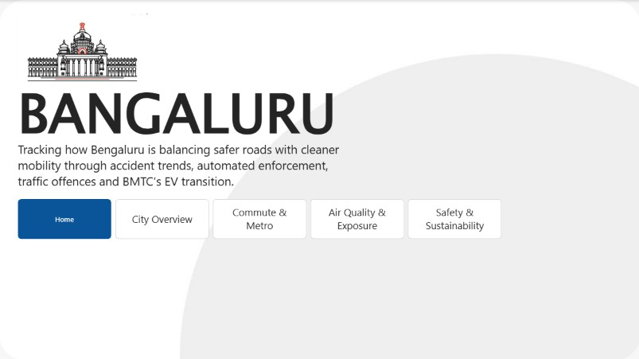
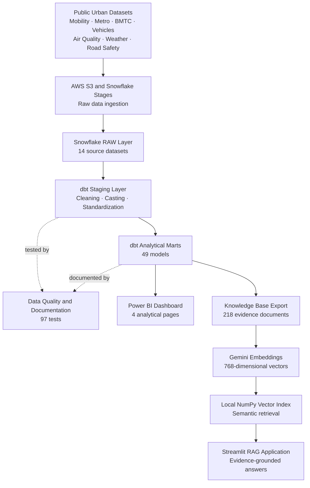
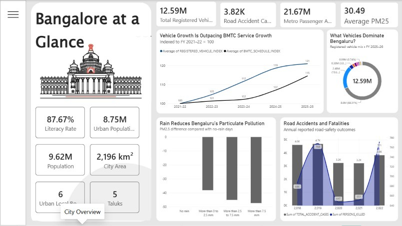
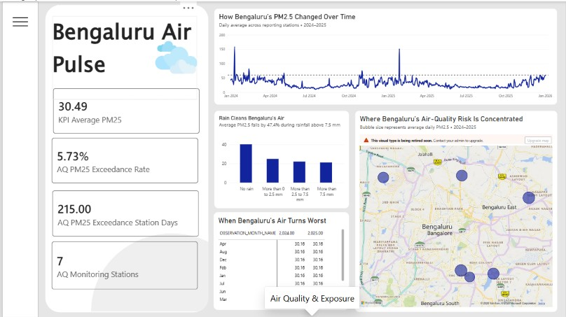
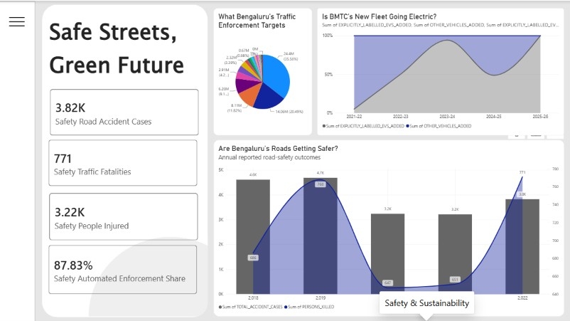
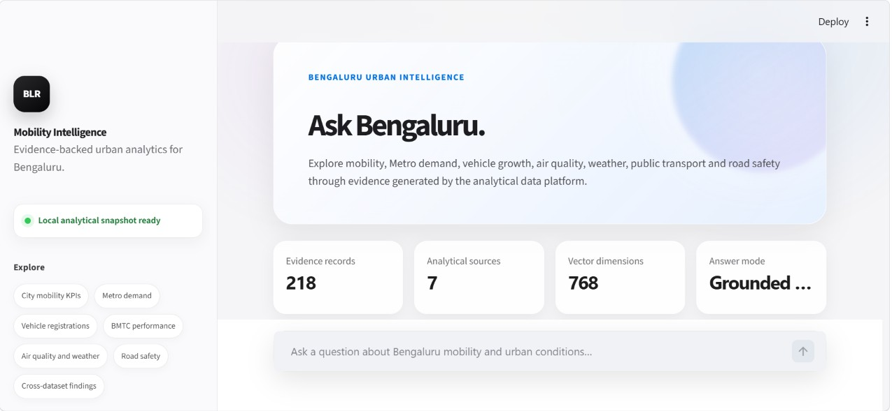
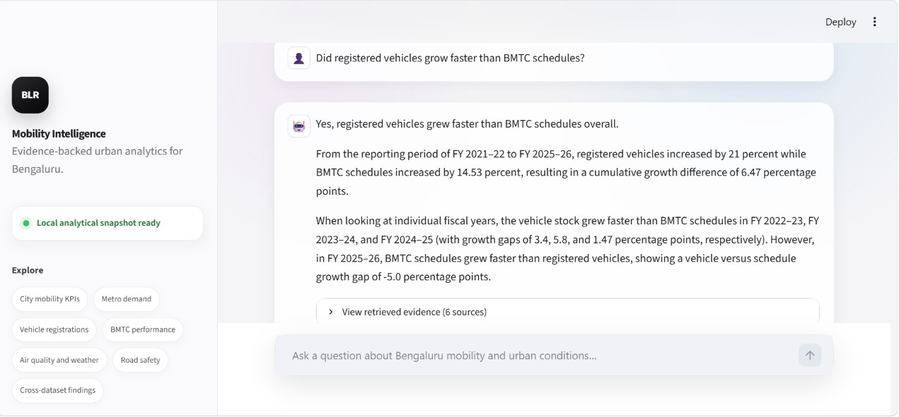
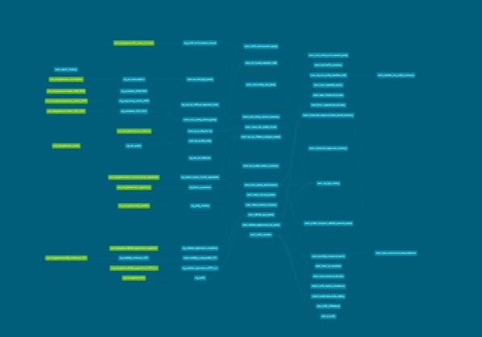

<div align="center">

# Bengaluru Urban Mobility Intelligence

### An end-to-end analytics engineering, business intelligence and AI system for understanding Bengaluru’s mobility, environment and road safety.

Built with **Snowflake, dbt, Power BI, Python, Gemini and Streamlit**

[Dashboard PDF](docs/Bengaluru_Mobility_Dashboard.pdf) ·
[Power BI File](powerbi/Bengaluru_Urban_Mobility_Intelligence.pbix) ·
[Architecture](docs/PROJECT_ARCHITECTURE.md) ·
[dbt Lineage](#dbt-lineage)

</div>

---



## Project overview

Bengaluru Urban Mobility Intelligence is an end-to-end data platform that
combines transportation, vehicle registration, public transit, traffic,
weather, air quality, road safety and enforcement datasets.

The project converts heterogeneous public datasets into tested analytical
models, interactive Power BI dashboards and an evidence-grounded
retrieval-augmented generation application.

The system was designed to answer questions such as:

- Is private-vehicle growth outpacing public-transport growth?
- Which Metro stations experience the highest passenger demand?
- Which areas and roads carry the greatest commute burden?
- How are rainfall, humidity and wind associated with air pollution?
- What do road-accident and enforcement trends reveal?
- Can analytical findings be explored through natural-language questions?

## Portfolio highlights

| Component | Result |
|---|---:|
| Source datasets | 14 |
| dbt models | 49 |
| Table models | 31 |
| View models | 18 |
| Data tests | 97 |
| Successful dbt build tasks | 146 |
| Power BI pages | 4 |
| RAG evidence documents | 218 |
| Embedding dimensions | 768 |
| Build result | 146 passed, 0 errors |

## Key analytical findings

| Finding | Result | Reporting period |
|---|---:|---|
| Registered vehicles | 12.59 million | FY 2025–26 |
| Metro passenger activity | 21.67 million entries plus exits | September 2025 |
| Weighted average daily PM2.5 | 30.49 µg/m³ | 2024–2025 |
| PM2.5 exceedance station-days | 215 | 2024–2025 |
| PM2.5 exceedance rate | 5.73% | 2024–2025 |
| BMTC vehicles held | 6,981 | FY 2025–26 |
| BMTC schedules operated | 6,281 | FY 2025–26 |
| Registered-vehicle growth | 21.00% | FY 2021–22 to FY 2025–26 |
| BMTC schedule growth | 14.53% | FY 2021–22 to FY 2025–26 |
| Vehicle-versus-schedule growth gap | 6.47 percentage points | FY 2021–22 to FY 2025–26 |
| PM2.5 difference on heavy-rain days | −47.40% versus no-rain days | 2024–2025 |
| Humidity–PM10 correlation | −0.536 | 2024–2025 |

> Correlations and observational differences describe associations in the
> available datasets. They should not be interpreted as causal estimates.

## End-to-end architecture



## Technology stack

| Layer | Technology |
|---|---|
| Data sources | Bengaluru public and open datasets |
| Object storage | AWS S3 |
| Cloud warehouse | Snowflake |
| Transformation | dbt Core and dbt-snowflake |
| Data quality | dbt generic and custom tests |
| Documentation | dbt Docs and lineage |
| Business intelligence | Microsoft Power BI |
| Programming | Python 3.11 |
| Embeddings | Gemini Embedding |
| Generation | Gemini Flash |
| Vector storage | NumPy |
| AI application | Streamlit |
| Version control | Git and GitHub |

## Data pipeline

1. Public datasets are collected across mobility, transport, pollution,
   weather, vehicle registration and road safety domains.
2. Raw files are staged and loaded into Snowflake.
3. dbt staging models standardize names, types, dates and source-specific
   quality rules.
4. Analytical marts calculate city KPIs, time trends, station summaries,
   commute burden, public-transport pressure and cross-dataset findings.
5. dbt tests validate keys, required fields and business-level assumptions.
6. Power BI consumes the curated marts for executive and exploratory pages.
7. Selected reporting marts are exported into a local RAG knowledge base.
8. Gemini embeddings and a local NumPy index support semantic retrieval.
9. The Streamlit application generates answers using retrieved project
   evidence.

## Power BI dashboard

The report contains four analytical pages designed for different decision
questions.

### 1. Bengaluru City Overview

A city-level summary of population context, registered vehicles, public
transport, pollution and major urban indicators.


### 2. Commute Anatomy

Examines Metro passenger demand, hourly travel patterns, congestion burden,
travel-time index and weekday-versus-weekend behaviour.



### 3. Bengaluru Air Pulse

Explores PM2.5, PM10 and other pollutants across monitoring stations, weather
conditions and reporting periods.



### 4. Safe Streets, Green Future

Combines road-safety trends, enforcement patterns, vehicle composition,
public-transport pressure and sustainability indicators.



### Dashboard downloads

- [Download the dashboard PDF](docs/Bengaluru_Mobility_Dashboard.pdf)
- [Download the Power BI PBIX file](powerbi/Bengaluru_Urban_Mobility_Intelligence.pbix)

## Evidence-grounded RAG application

The Streamlit application allows users to ask natural-language questions about
the curated Bengaluru analytical datasets.

It uses:

1. A local JSON knowledge base generated from selected Snowflake marts.
2. Gemini embeddings for every evidence document.
3. Semantic similarity retrieval against a NumPy embedding matrix.
4. Gemini Flash for generating answers from retrieved evidence.
5. Expandable source citations so users can inspect the retrieved records.

The deployed application does not require a live Snowflake connection. It uses
the committed analytical snapshot and embedding index.

### Application interface



### Evidence-grounded answer



## dbt transformation layer

The dbt project is divided into:

### Staging models

Staging models clean and standardize individual source datasets, including:

- Air-quality measurements
- Daily weather observations
- Traffic and travel-time records
- Metro station activity
- BMTC operational data
- Vehicle-registration snapshots
- Road accidents and fatalities
- Traffic-enforcement cases
- EV consumption
- Mobility and health-context indicators

### Analytical marts

The marts support:

- City KPI reporting
- Air-quality trends
- Weather and pollution comparisons
- Area-level commute burden
- Metro station and hourly-demand analysis
- BMTC reliability and operational recovery
- Vehicle-type and registration trends
- Road-safety summaries
- Traffic-enforcement trends
- Cross-dataset executive findings

## dbt lineage

The following lineage graph shows the upstream models contributing to the
final report-findings mart.



The reporting mart acts as a semantic findings layer for both dashboard
narratives and the RAG knowledge base.

## Data sources

| Domain | Example data |
|---|---|
| Air quality | Hourly observations from seven Bengaluru monitoring stations |
| Weather | NASA POWER daily weather and Bengaluru rainfall history |
| Traffic | Road, area and hourly traffic indicators |
| Metro | Station-level passenger entries and exits |
| BMTC | Fleet, schedule and operational performance |
| Vehicle registration | Annual city totals and vehicle-type distributions |
| Road safety | Accident, fatality, injury and station-level records |
| Enforcement | Motor Vehicles Act cases, fines and offence categories |
| EV and mobility | EV consumption, charging and mobility indicators |
| Health context | Respiratory mortality context data |

## Repository structure

```text
Bangalore/
├── bangalore_dbt/
│   ├── analyses/                  # Exploratory analytical SQL
│   ├── macros/                    # Custom dbt macros
│   ├── models/
│   │   ├── staging/               # Cleaned source-aligned views
│   │   └── marts/                 # Business-ready analytical tables
│   ├── llm_app/
│   │   ├── app.py                 # Streamlit interface
│   │   ├── rag_engine.py          # Retrieval and generation logic
│   │   ├── build_knowledge_base.py
│   │   ├── build_embeddings.py
│   │   ├── requirements.txt
│   │   ├── assets/
│   │   └── data/
│   │       ├── knowledge_base.json
│   │       ├── embeddings.npy
│   │       └── embedding_manifest.json
│   └── dbt_project.yml
├── dataset/                       # Original project datasets
├── docs/
│   ├── images/                    # Dashboard, RAG and lineage images
│   ├── Bengaluru_Mobility_Dashboard.pdf
│   └── PROJECT_ARCHITECTURE.md
├── powerbi/
│   └── Bengaluru_Urban_Mobility_Intelligence.pbix
└── README.md
```

## Run the Streamlit application locally

### 1. Create an environment

From the repository root:

```bash
python -m venv .rag_venv
source .rag_venv/Scripts/activate
```

For Windows PowerShell:

```powershell
.rag_venv\Scripts\Activate.ps1
```

### 2. Install dependencies

```bash
pip install -r bangalore_dbt/llm_app/requirements.txt
```

### 3. Configure Gemini

Copy:

```text
bangalore_dbt/llm_app/.env.example
```

to:

```text
bangalore_dbt/llm_app/.env
```

Then configure:

```text
GEMINI_API_KEY=your_api_key
```

Never commit the real `.env` file.

### 4. Run the application

```bash
cd bangalore_dbt/llm_app
python -m streamlit run app.py
```

Open:

```text
http://localhost:8501
```

## Rebuild the RAG knowledge base

Rebuilding requires an active Snowflake connection and the required environment
variables.

```bash
cd bangalore_dbt/llm_app
python build_knowledge_base.py
python build_embeddings.py
```

The application itself can run from the existing local snapshot without
rebuilding these files.

## Run the dbt project

Create a local dbt `profiles.yml` containing your Snowflake connection. Do not
commit credentials.

Then run:

```bash
cd bangalore_dbt
dbt debug
dbt build
```

Final verified build:

```text
PASS=146
WARN=0
ERROR=0
SKIP=0
TOTAL=146
```

## Project limitations

- Source datasets cover different reporting periods and granularities.
- Vehicle registrations do not represent the number of vehicles used daily.
- Monitoring stations do not provide uniform coverage of every city area.
- Weather and pollution comparisons are observational, not causal.
- Metro passenger data represents the available station reporting period.
- The committed RAG data represents a fixed analytical snapshot.
- Refreshing Snowflake-derived datasets requires an active warehouse account.
- Public Power BI publishing should only be used because the project contains
  non-sensitive public analytical data.

## Future improvements

- Automated orchestration and scheduled refreshes
- CI checks for dbt models and Python code
- Geospatial ward and road-level visualizations
- Forecasting of ridership, pollution and accident risk
- Incremental ingestion of new reporting periods
- Cloud-hosted vector database for larger knowledge bases
- Expanded model and source documentation
- Automated dashboard refresh when warehouse access is available

## Author

**Mohit**

GitHub: [MOHITX101](https://github.com/MOHITX101)

---

<div align="center">

Built as a portfolio case study in analytics engineering, business
intelligence and applied generative AI.

</div>