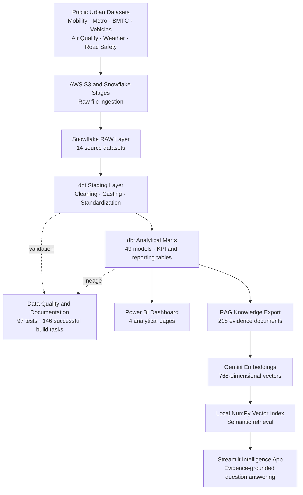

# Bengaluru Urban Mobility Intelligence — Architecture

The platform combines cloud data warehousing, analytics engineering, business
intelligence and retrieval-augmented generation to analyze Bengaluru's
transportation, safety and environmental conditions.

## Analytical flow

| Layer | Technology | Responsibility |
|---|---|---|
| Data sources | Public datasets | Mobility, transit, vehicles, weather, pollution and safety data |
| Storage and ingestion | AWS S3 and Snowflake | Durable raw-data storage and warehouse ingestion |
| Transformation | dbt | Standardization, business logic, testing and documentation |
| Analytical layer | Snowflake marts | Reusable KPI, trend and reporting datasets |
| Business intelligence | Power BI | Interactive executive and exploratory dashboards |
| Retrieval layer | Gemini embeddings and NumPy | Semantic retrieval over curated analytical evidence |
| AI application | Streamlit and Gemini | Natural-language answers supported by retrieved evidence |

## Offline portfolio design

The Power BI report uses imported data, while the Streamlit application uses
the saved knowledge base and embedding index. Therefore, the portfolio remains
demonstrable even when the original Snowflake trial warehouse is unavailable.